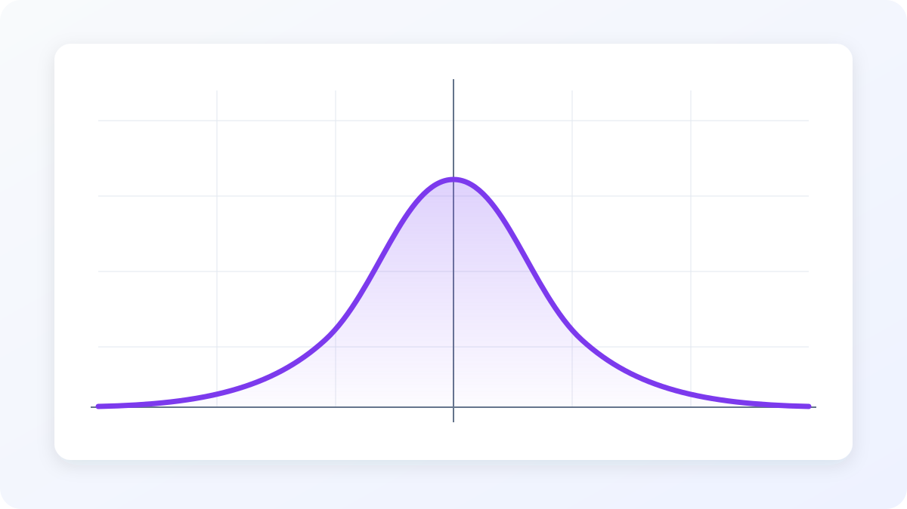
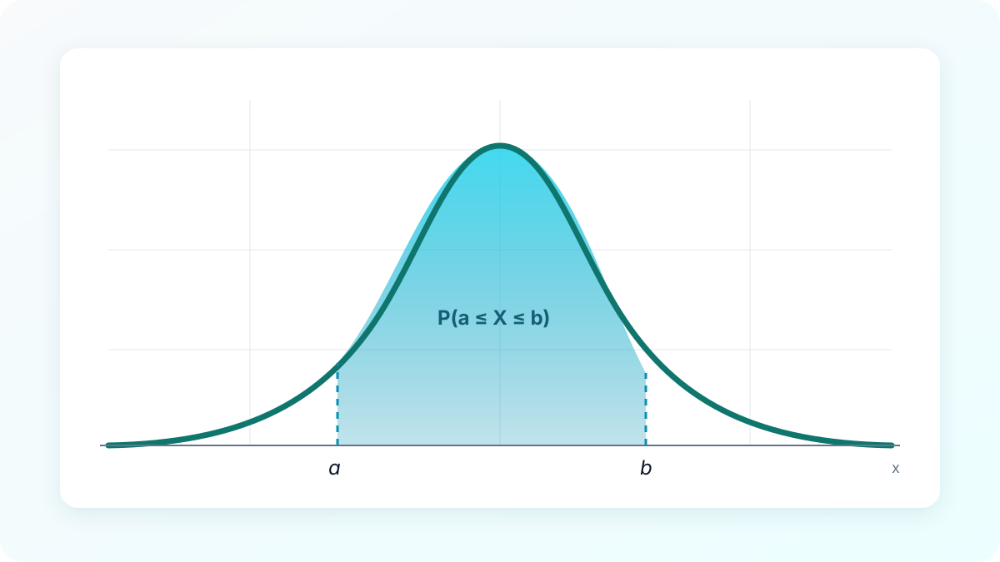
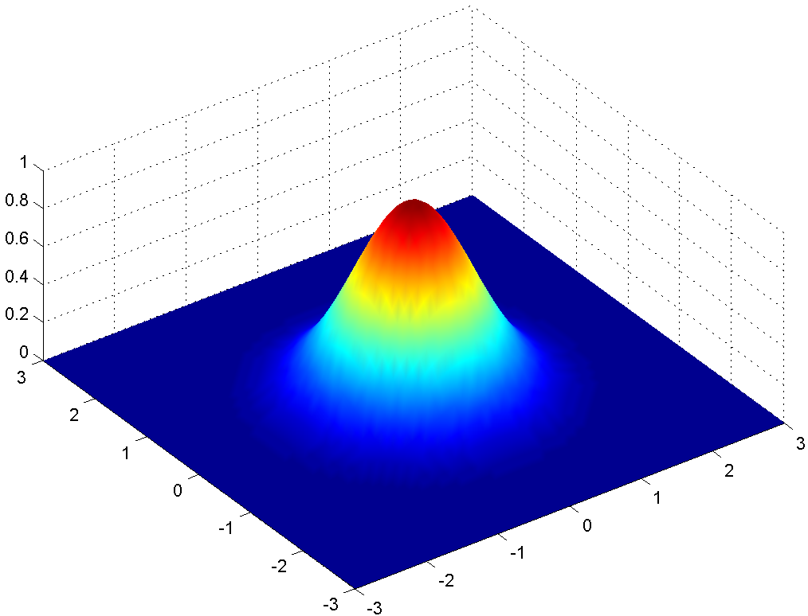
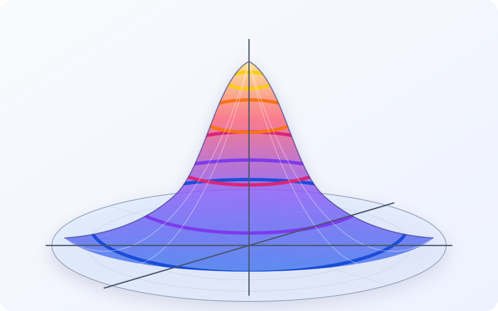
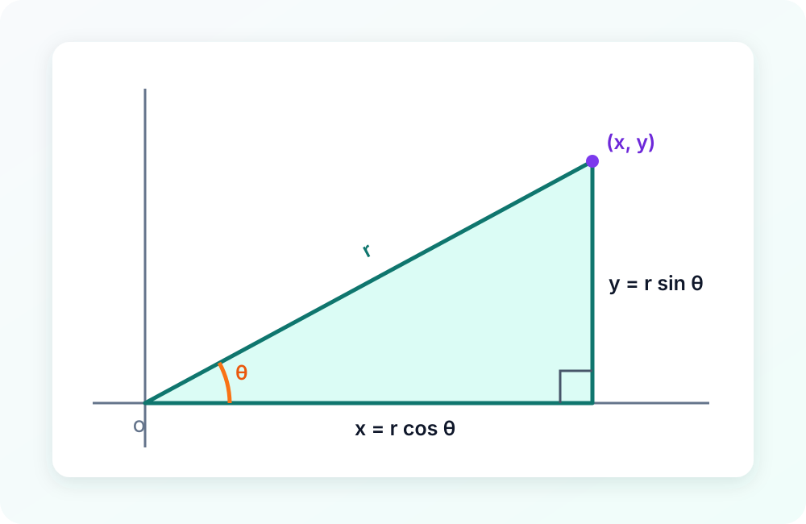

This is my first post here. I am mostly using this post as a way to trial and experiment with the way this template works. I am still experimenting, so things may not be as pretty right now.

## Introduction

The *bell curve* is certainly something everyone has heard of, whether for accusing it for not getting as high of a grade in an exam as they would've expected, or about the *Normal Distribution* in an introductory statistics class. However, most people don't know where this bell curve comes from or how is modelled mathematically. Probably because high school statistics (H2 Math) mostly skip over it entriely and instead reducing statistical problems to bashing a graphing calculator.

Today I wish to how the mathematical model behind the *bell curve* leads to one of the world's most famous (and also one of my favourite) integrals.

## Motivation

Recall the *Normal Distribution*, a continous random variable $X$ having a *probability density function* (p.d.f.) of

$$
\begin{equation}
f(x) = \frac{1}{\sigma\sqrt{2\pi}}e^{-\dfrac{(x-\mu)^2}{2\sigma^2}}, \qquad \sigma>0
\end{equation}
$$

{: width="1200" height="675" }

In most textbooks, we denote the distribution as $N(\mu, \sigma^2)$

Suppose that the mean score $(\mu)$ of a test is $50$ with a variance of $1$, and assuming a perfect scenario where the distribution of the test scores perfectly follow a normal distribution. We can find the probability that a random student's score is at most $10$ from the mean by evaluating the following integral

$$
\int_{40}^{60} \frac{1}{\sqrt{2\pi}}e^{-\dfrac{(x-50)^2}{2}} \ dx
$$

We can also intepret this as the area under the gaussian fucntion $f(x)$ from $x = 40$ to $x = 60$

In general, we can compute

$$
P(a \le X \le b) = \int_{a}^{b} f(x) \ dx
$$

{: width="1200" height="675" }

We can already see the importance of this result in statistics, allowing us to compute the answers of many probability problems with just calculating this integral.

Turns out that, apart from its applications, it is also way more beautiful than we thought.

Suppose we set $\mu = 0$ and $\sigma^2=\dfrac{1}{2}$ and strip away the normalising constant of the probability distribution function, i.e. we reduce p.d.f. into its purest form, which is

$$
f(x) = e^{-x^2}
$$

This function is famously known as the *gaussian function* as it describes the famously known bell-curve shape. For such a function $f(x)$ to be intepreted as a probability distribution, a requirement is for its area under this function to be exactly equal to 1. i.e.

$$
\begin{equation}
\int_{-\infty}^{\infty} f(x) \ dx = 1
\end{equation}
$$

This makes sense. The integral of a probability density across all values that a continous random variable can take should be equal to $1$, similar to how the sum of proabilities across all events in a sample space is equal to $1$. Unfortuantely, the pure gaussian function $f(x) = e^{-x^2}$ does not actually satisfy this rule. So, why is this function the one being used to model the normal distribution, that we utilise so much in statistics?

Notice that when $\sigma^2=\dfrac{1}{2}$ in the original probability distribution function shown in $(1)$, there is one sneaky little constant $\sqrt{\pi}$ hiding inside. What does $\pi$ have to do with a distribution function modelling a population? This was a question that skeptical statisticians asked in ancient mathematics, and I will attempt to answer that today.

Well it turns out that if we divide the pure gaussian function by $\sqrt{\pi}$, we actually satisfy equation $(2)$

$$
\begin{equation}
\frac{1}{\sqrt{\pi}}\int_{-\infty}^{\infty} f(x) \ dx = 1
\end{equation}
$$

Whaa?, this means that the area under the graph of the gaussian function is actually $\sqrt{\pi}$ ! Instead of $1$, we get a more sneaky, peculiar, but interesting result. This result gives rise to the p.d.f. modelling the normal distribution shown in $(1)$ (why the $\sqrt{\pi}$ appears when $\sigma^2=\dfrac{1}{2}$), and a change of scale gives the well known p.d.f. we know today.

## The classic proof

Let's prove that the area under the graph of $f(x) = e^{-x^2}$ is $\sqrt{\pi}$ by first illustrating perhaps the most well known method, which is through methods of *multivariable calculus*.

Let

$$
I = \int_{-\infty}^{\infty} e^{-x^2} \ dx
$$

In computing definite integrals like these, the usual procedure is to find an *elementary antiderivative $F(x)$* such that $F'(x) = f(x)$, and then use the fundamental theorem of calculus to compute the area.

However, in this case there is no such elementary antiderivative! In fact the *Risch algorithm* can establish that it is impossible to find such an elementary antiderivative. So ... what do we do?

We need some form of clever trick here, in which we will start with perhaps the most absurd and unintuitive one. Let us compute the square of the integral, $I^2$ instead.

$$
I^2 = (\int_{-\infty}^{\infty} e^{-x^2} \ dx)^2
$$

This looks extremely out of the blue, but there is actually an interesting motivation behind this which I might explain in another blog. But anyways, by squaring the integral, we take the integral from one dimension, to $2$ dimensions!

$$
I^2 = (\int_{-\infty}^{\infty} e^{-x^2} \ dx)(\int_{-\infty}^{\infty} e^{-y^2} \ dy)
$$

$$
= \int_{-\infty}^{\infty} \int_{-\infty}^{\infty} e^{-(x^2 + y^2)} \ dx \ dy
$$

We can intepret this new integral as finding the **volume** under the surface $f(x, y) = e^{-(x^2 + y^2)}$ across the entire $xy$-plane.

{: width="1014" height="774" }
_Source: [Kghose, "Gaussian 2d", Wikimedia Commons](https://commons.wikimedia.org/wiki/File:Gaussian_2d.png), licensed under [CC BY-SA 3.0](https://creativecommons.org/licenses/by-sa/3.0/)._

This does not look any less daunting than the original integral, but there is something we can abuse, in particular the $x^2 + y^2$ term.

If we set $x^2 + y^2 = r^2$ for some fixed $r$, we recgonise this as the equation of a circle of radius $r$ and centre at origin. Here $r$ is the distance of the point $(x, y)$ from the origin. Hence $x^2 + y^2$ gives the **square** of this distance $r$. We can also notice that for all points $(x, y)$ on the same circle, $f(x, y)$ is also constant. i.e. the output of the function is always equal. This is also called a *level curve* of $f$.

{: width="1200" height="750" }

The horizontal circles denote (some of the) level curves of the surface

What does this have to with our integration problem. Well, what if there was a way to "change" the term $x^2 + y^2$ to instead be of a new single variable. Let us try substituing $x^2 + y^2$ to the single variable $r^2$! By doing this, we have mapped each point $(x,y)$ to its distance $r$ from the origin.

Of course, $r$ alone does not uniquely determine the original point $(x,y)$. Because we still need another variable to accompany $r$ in this double integral problem.

Let us consider the right angle triangle a point $(x, y)$ makes with the origin:

{: width="1000" height="650" }

The triangle makes an angle $\theta$ with the $x$-axis. From simple trigonometry, we see that:

$$
x = r \cos{\theta} \\
y = r \sin{\theta}
$$

This satisfies $x^2 + y^2 = (r \cos{\theta})^2 + (r \sin{\theta})^2 = r^2(\cos^2{\theta} + \sin^2{\theta}) = r^2$

What we have just done is the well known trick of change of variables using **polar coodinates**. In other words we convert rectangular coordinates $(x, y)$ to polar coordinates $(r, \theta)$, a new set of coordinates that better represents circles and distance from origin.

Let us substitute these new variables into the integral (without the bounds) to see what we have so far:

$$
= \int \int e^{-r^2} J(r, \theta)\ dr \ d\theta
$$

To determine the new bounds of this integral, we consider the range of values $r$ and $\theta$ can take. The radius $r$ of a circle (level curve) can stretch from $0$ all the way to infinity, hence $r \in [0, \infty)$. Additionally for any such circle regardless of radius, theta will always range from $0$ to $2 \pi$, giving us the bounds for $\theta$

We have one last value to evaluate, $J(r, \theta)$. This is known as the *jacobian determinant*, which appears whenever we do a coordinate transformation. This is also known as the *scaling factor* which is very important in givign us the correct answer for solving iterated integrals using change of variables. We can compute $J(r, \theta)$ as:

$$
J(r, \theta) = \left| \begin{matrix} \dfrac{\partial x}{\partial r} & \dfrac{\partial x}{\partial \theta} \\ \dfrac{\partial y}{\partial r} & \dfrac{\partial y}{\partial \theta} \end{matrix} \right|
= \left| \begin{matrix} \cos \theta & -r \sin \theta \\ \sin \theta & r \cos \theta\end{matrix} \right|
= (\cos \theta)(r \cos \theta) - (-r \sin \theta)(\sin \theta) = r(\cos^2{\theta} + \sin^2{\theta}) = r
$$

Now, we have the integral

$$
I^2 = \int_{0}^{2 \pi} \int_{0}^{\infty} r e^{-r^2}\ dr \ d\theta
$$

Finally, we have an iterated integral we can actually solve! Let us compute the inner integral first, which we can easily solve using $u$-substituion of $u = -r^2$. Then $du = -2r \ dr$. Changing the inner limits of integration, we then obtain:

$$
I^2 = \frac{1}{2}\int_{0}^{2 \pi} \int_{-\infty}^{0} e^u\ du \ d\theta \\
= \frac{1}{2}\int_{0}^{2 \pi} \left[ e^u \right]_{-\infty}^{0} \ d\theta \\
= \frac{1}{2}\int_{0}^{2 \pi} (1 - 0) \ d\theta \\
= \frac{1}{2}\int_{0}^{2 \pi} d\theta \\
= \frac{1}{2}\left[ \theta \right]_{0}^{2 \pi} \\
$$

and the result follows:
$$
I^2 = \pi \\
\boxed{I = \sqrt \pi}
$$

where we take the positive square root because $I>0$.

## The Feynman way

I want to introduce another method to compute the gaussian integral, using a really cool method I learnt recently, namely *Feynman's trick*. In my opinion, this is truly one of the most elegant and ingenious techniques when it comes to solving definite integral, because it can feel so out of the blue some times. You can read up about Feynman's technique here: [link](https://web.williams.edu/Mathematics/lg5/Feynman.pdf)

We have our integral:

$$
I = \int_{-\infty}^{\infty} e^{-x^2} \ dx
$$

First notice that the integrand is an even function, meaning $f(x) = f(-x)$. This implies that the graph of the integrand is symmetrical about the $y$-axis. Hence we can seperate $I$ as follows without changing the actual integral:

$$
I = 2 \int_{0}^{\infty} e^{-x^2} \ dx
$$

Let us give the integral a name, let

$$
\begin{equation}
J = \int_{0}^{\infty} e^{-x^2} \ dx
\end{equation}
$$

We would then want to compute the value of $2J$. Now here comes the fun part, the *essence* of the feynman technique, let us introduce a new integral with a *paramter* $a\ge 0$

$$
\begin{equation}
f(a) = \int_{0}^{\infty} \dfrac{e^{-a^2(1+x^2)}}{1+x^2} \ dx
\end{equation}
$$

How on earth do we motivate such an integral. Well I don't know how else to explain this other than "watch and see". But I guess one source of motivation is to recall that the Feynman trick always involves *differentiaing under the integral with respect to the paramter a*. If we do that to the integrand, as we would see later, we would produce a factor that would cancel the $1+x^2$ in the denominator.

Let us differentiate both sides of $(5)$ with respect to the parameter $a$ for $a>0$

$$
f'(a) = \int_{0}^{\infty} \frac{\partial}{\partial a}\dfrac{e^{-a^2(1+x^2)}}{1+x^2} \ dx \\
= \int_{0}^{\infty} (-2a)(1+x^2)\dfrac{e^{-a^2(1+x^2)}}{1+x^2} \ dx \\
= \int_{0}^{\infty} (-2a)e^{-a^2(1+x^2)} \ dx \\
= \int_{0}^{\infty} (-2a)e^{-a^2(1+x^2)} \ dx
$$

$$
\begin{equation}
f'(a) = (-2ae^{-a^2})\int_{0}^{\infty} e^{-a^2x^2} \ dx
\end{equation}
$$

Let us use a u-substituion to "try" to evaluate the improper integral in $(6)$. Let $u = ax$, then $du = a dx$ with the limits remaining unchanged since $a>0$.

$$
f'(a) = (-2ae^{-a^2})\int_{0}^{\infty} e^{-u^2} \ \frac{du}{a} \\
$$

$$
\begin{equation}
= (-2e^{-a^2})\int_{0}^{\infty} e^{-u^2} \ du
\end{equation}
$$

We make an interesting observation, the improper integral in $(7)$ is **exactly** equal to $J$ as defined in equation $(4)$. The variable $u$ is just a dummy variable for $x$ for a definite integral with equal limits. Hence we can rewrite $f'(a)$ as:

$$
\begin{equation}
f'(a) = (-2e^{-a^2}) \ J
\end{equation}
$$

The objective of our problem is to compute the value of $2J$. We now have a nice relationship connecting $f'(a)$ with $J$. In Feynman's trick. Whenever we have a promising form like this, we will then start to integrate both sides of this equation

$$
\int_{0}^{\infty} f'(a)\,da = \int_{0}^{\infty}(-2e^{-a^2}) \ J \ da \\
\left[ f(a) \right]_{0}^{\infty} = -2J \int_{0}^{\infty} e^{-a^2} da \\
$$

$$
\begin{equation}\lim_{a \to \infty} (f(a)) - f(0)= -2J^2 \end{equation}
$$

Next up, we need to find the values of $\lim\limits_{a \to \infty} (f(a))$ and $f(0)$. As computing them would require some work unrelated to our integral, I would just give their answers as $0$ and $\dfrac{\pi}{2}$ respectively. Read the appendix below if you are interested in their derivations.

From $(9)$, we have:

$$
0 - \frac{\pi}{2}= -2J^2 \\
J^2 = \frac{\pi}{4} \\
J = \dfrac{\sqrt{\pi}}{2}
$$

Our final result follows:

$$
\boxed{I = \sqrt{\pi}}
$$

## Final Thoughts

That concludes my first blog. Sometimes I think Integration can be truly beautiful, testing the limits of human creativity, espescially with absured novel tricks like Feynman's trick that I just cannot fathom how humans can derive. Anyways, that concludes two beautiful proofs behind the Gaussian integral, a fundamental idea behind the Normal Distribution aka. the bell curve.

Hopefully more blogs to come.

## Appendix
$$
f(a) = \int_{0}^{\infty} \dfrac{e^{-a^2(1+x^2)}}{1+x^2} \ dx
$$

Claim: $\lim\limits_{a \to \infty} (f(a)) = 0$

Proof:

We know that $1 + x^2 > 0$ for all $x > 0$. Hence:

$$
0 \le e^{-a^2(1+x^2)} \le e^{-a^2}
$$

Divinding both sides by $1 + x^2$, and then integrating over $(0, \infty)$, we have:

$$
0 \le f(a) \le e^{-a^2} \int_{0}^{\infty} \dfrac{1}{1+x^2} \ dx \\
0 \le f(a) \le \frac{\pi}{2}e^{-a^2}  \\
$$

Taking the limits as $a \rightarrow \infty$:

$$
0 \le \lim_{a \to \infty}f(a) \le 0
$$

It follows from the squeeze theorem that $\lim\limits_{a \to \infty} (f(a)) = 0$

Claim: $f(0) = \dfrac{\pi}{2}$

Proof:

$$
f(a) = \int_{0}^{\infty} \dfrac{e^{-a^2(1+x^2)}}{1+x^2} \ dx \\
f(0) = \int_{0}^{\infty} \dfrac{1}{1+x^2} \ dx \\
= \left[ \arctan x \right]_{0}^{\infty} \\
= \dfrac{\pi}{2}
$$

Note that when obtaining equation $(6)$, the validity of the first step -- putting the partial derivative inside the integral, is due to the well known result of  *Leibniz rule*. For $a>0$, this is justified because the derivative is dominated by an integrable function on every closed interval of positive $a$-values. Read more here: [link](https://en.wikipedia.org/wiki/Leibniz_integral_rule)

